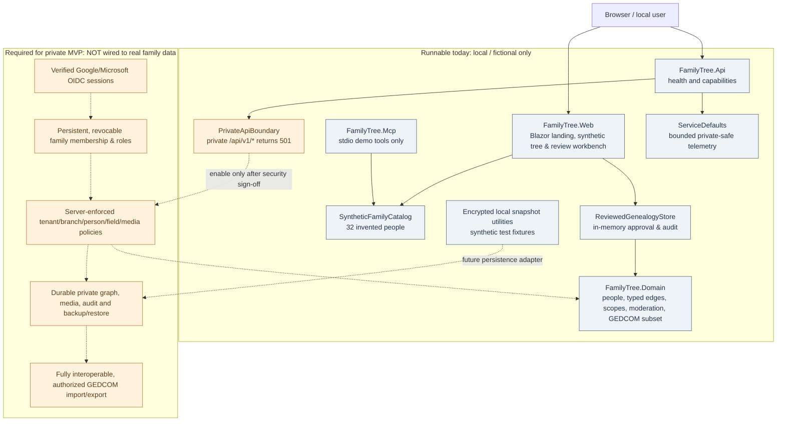

# FamilyTree architecture

FamilyTree separates genealogy Persons from authentication identities and keeps private access denied until trustworthy identity, persisted membership, scoped authorization and audit are integrated. Solid arrows below describe an existing local/synthetic flow. Dashed arrows are **planned integrations**, not enabled production connections.

## Component diagram

**Reading the diagram:** The public local explorer reads a fictional catalog, not a private database. The workbench simulates review authority with fictional identities and does not persist user input. API `/api/v1` private routes deliberately return 501 until the complete security chain is verified. The proposed identity and persistence path is explicitly not operational.

## Trust boundaries and data flows

| Boundary | Enforced now | Release dependency |
| --- | --- | --- |
| Public web demo | Fictional-only catalog and local-only review workbench | Do not bind real family repositories to demo routes |
| Private HTTP API | Default-deny 501 for family endpoints | Real verified OIDC, persisted active membership, scoped queries, audit |
| Genealogy graph | Family/branch/person/field filtering and no-hidden-edge domain tests | Integrate in authenticated HTTP query handlers and deny-by-default storage |
| Mutation review | Immutable pending/approve/reject lifecycle and non-self-approval rules | Authenticate actor/moderator, ensure transactional persistence/reversal |
| Import/export | Bounded metadata preflight and partial synthetic GEDCOM handling | Standards conformance, full round-trip, duplicate review, authorized exports |
| AI/MCP | Opt-in proposal controls; remote data access disabled | Auth, origin/host validation, capability consent, rate limiting and human review |
| Telemetry | Bounded, low-cardinality synthetic/local counters | Retention, access review, consent and verified privacy-safe exporter settings |

## Architectural decisions

- **ADR-001:** Standalone FamilyTree codebase, separate from Family Hub.
- **ADR-002:** GEDCOM 7 primary exchange, with sidecar JSON for consent, gratitude and app-specific semantics.
- **ADR-003:** .NET 11 GA, web UI, API, domain modules and optional local Aspire orchestration.
- **ADR-004:** Deny by default at the server and data-query boundaries. No publicly searchable living-person directory.
- **ADR-005:** Genealogy Person records are independent of authenticated, opt-in family members.
- **ADR-006:** Multiple independent typed relationship edges per pair with provenance; distinguish genealogical and social links.
- **ADR-007:** OIDC, administrator-approved membership/profile claims and independently moderated changes.
- **ADR-008:** Provider-neutral AI and local/remote MCP with permission-filtered retrieval, citations and no automatic publication.
- **ADR-009:** One portable codebase with self-hosted/hosted possibilities, adapter boundaries and no mandatory paid provider.
- **ADR-010:** Evaluate external genealogy tooling for compatibility and license fitness without making it a runtime dependency.

## Delivery and compliance gates

The private MVP cannot be called complete until integration testing proves tenant isolation, unknown/denied ID equivalence, verified identity, revocation, minor/media privacy, authenticated editing and reversible audit, authorized GEDCOM exports, reliable persistence and backup/restore. The repository is public and uses synthetic fixtures only.

GDPR lawful basis, rights handling, retention, incident response, minors and jurisdiction-specific requirements need qualified review before public hosting. In-app feedback must exclude private data from GitHub issues. Managed telemetry and paid hosting require explicit owner approval.

See [M0 architecture decisions](architecture_decisions_m0.md), [identity design](identity_and_membership_design.md), [security boundary](private_api_security_boundary.md), and [cost policy](cost_policy.md).
