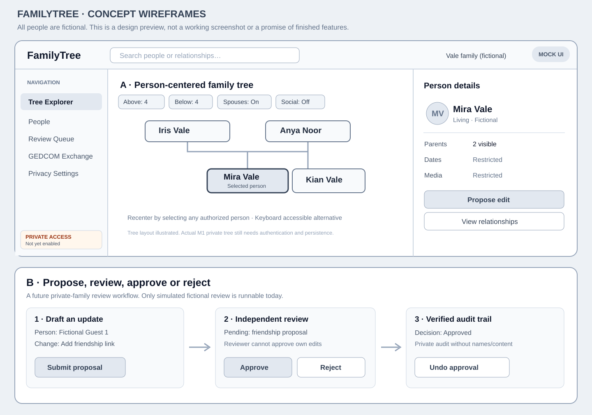

# FamilyTree

> Privacy-first family genealogy. **Version 0.1.0, pre-MVP.** This public repository uses fictional demonstration data only.

FamilyTree is an open-source, standards-oriented family heritage project, independent of Family Hub. Its aim is to help families preserve relationships and stories with explicit control over who can see or change each detail.

## What the app could look like



*Design wireframe, not a screenshot or production feature promise.* The tree navigator and fictional editing workbench already exist locally in simpler forms. The integrated private tree, real users, persistent review queue and full genealogy editing remain M1 work.

### Main interaction flows

| Area | Intended experience | Current availability |
| --- | --- | --- |
| Tree | Center a person, adjust ancestor/descendant depth, follow relationships | Fictional explorer and local SVG prototype; real family graph still blocked |
| People | Add people and create independent parent, partner or social links | Synthetic local workbench only |
| Review | Propose a change, approve/reject independently, undo approved edits | Fictional local workbench only |
| Privacy | Family, branch, person, field and media access policies | Domain rules; private-family API remains fail-closed |
| Import/export | GEDCOM 7 migration, previews, controlled export | Bounded subset implementation; full interoperability still in progress |

## Run the fictional demo locally

Requirements: [free .NET 11 SDK](https://dotnet.microsoft.com/download/dotnet/11.0) and Git. On Windows PowerShell:

```powershell
git clone https://github.com/Jamula/FamilyTree.git
cd FamilyTree
dotnet restore FamilyTree.slnx
dotnet run --project src/FamilyTree.Web/FamilyTree.Web.csproj --urls http://127.0.0.1:5182
```

Open **http://127.0.0.1:5182/demo** for the 32-person fictional explorer, or **http://127.0.0.1:5182/demo/workbench** for the local-only fictional create/review/link/undo workflow. The workbench resets at restart and must not be used for private or actual family records.

## Core design commitments

- Privacy defaults to **deny**. A login is not a genealogy Person or an automatic family membership.
- Preserve multiple typed independent relationships, including social associations and their provenance.
- Use GEDCOM 7 for interoperability and a versioned sidecar for concepts GEDCOM cannot preserve.
- Human approval controls updates; AI and remote agent tools cannot silently publish family data.
- Support an eventual self-hosted and hosted codebase without proprietary data lock-in.

## Architecture and delivery

- [Architecture and trust boundaries](docs/architecture.md), including a Mermaid diagram.
- [Local development](docs/development.md), [test strategy](docs/test_strategy.md), and [release readiness](docs/release_readiness.md).
- [Cost policy](docs/cost_policy.md) and [security boundary](docs/private_api_security_boundary.md).
- [GitHub issues](https://github.com/Jamula/FamilyTree/issues) and [pull requests](https://github.com/Jamula/FamilyTree/pulls) are the live source of work status.

**Current status:** The .NET 11 web app/API, fictional demo, domain authorization and moderation primitives, local observability, security tests, and smoke tests run in CI. A functional private-family MVP remains unaccepted. Private-family data endpoints stay blocked; no production identity provider or real genealogy data is exposed.

**Cost and version controls:** Product version stays at **0.1.0** until explicit MVP acceptance. No incremental paid hosting or cloud services without approval.

## Privacy notice

**Never commit real relatives' identities, photos, birth/death dates, contacts, chat exports, GEDCOM files, authentication credentials, or secrets to this public repository.** Use only wholly fictional fixtures. Server authorization, not a hidden UI element, must enforce visibility.
